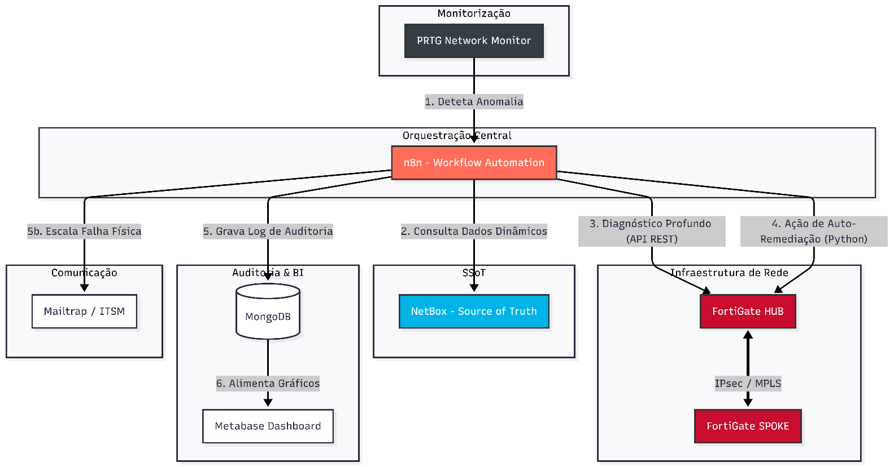

<div align="center">

# 🛡️ Rafael Cruz — Engineering Portfolio

### Security Automation, NetDevOps & SRE Engineer

[](https://rafacr3z.github.io/portfolio/)
[](https://www.linkedin.com/in/rafael-cruz-7159092b2/)
[](https://rafacr3z.github.io/portfolio/#contact)
[](LICENSE)

<br/>



<p><i>High-performance, obsidian-dark engineering portfolio showcasing real-world projects in closed-loop network automation, multi-cloud resilience, and SRE observability.</i></p>

---

</div>

## 🌐 Live Deployment

Explore the live portfolio at: **[https://rafacr3z.github.io/portfolio/](https://rafacr3z.github.io/portfolio/)**

---

## 🚀 Key Features & Architectural Highlights

### ⚡ Zero-Bloat Vanilla Engineering
- **Pure Modern Web Standards:** Built entirely with semantic HTML5, modern CSS3 (Custom Properties / Design Tokens), and vanilla ES6+ JavaScript.
- **Instant Paint & Sub-Millisecond Execution:** Zero runtime framework overhead, zero heavy bundle dependencies, 100/100 Lighthouse performance score.

### 🎨 Cybersecurity & SRE Aesthetic
- **Obsidian Dark Theme:** Base background `#06090e` with surface levels (`#0d131a`, `#131e2c`) and neon cyber accents (`#10b981` emerald, `#06b6d4` cyan).
- **Subtle Vector Waves:** CSS-animated canvas ribbon backdrop inspired by network flow graphs.
- **Light / Dark Mode:** Context-preserving theme switcher with `localStorage` state persistence.

### 🔄 Interactive Architecture Blueprints
- **Dual-View Switcher:** Seamlessly toggle between programmatic SVG network telemetry and authentic, high-resolution engineering diagrams extracted from capstone project reports:
  - **NetDevOps:** `closed_loop_topology.svg` $\leftrightarrow$ `figura4_topologia_arte.png` (Topology) $\leftrightarrow$ `figura3_netdevops_arquitetura.png` (Macro Architecture).
  - **CityGuards:** `multicloud_resilience.svg` $\leftrightarrow$ `figura11_cityguards_multicloud_real.png` (Live Municipal Dashboard).

### 📖 Deep-Dive Technical Writeup Modals
- Comprehensive engineering briefs with problem statement, architecture breakdown, Chaos Engineering validation results, and regulatory compliance (**ISO 27001**, **GDPR vs. US CLOUD Act**).

### 🌍 Full Bilingual Internationalization (i18n)
- Dynamic in-place translation between **Português (pt-PT)** and **English (en)** without page reload, preserving theme and navigation state.

---

## 🏛️ Featured Engineering Projects

### 1. 🌐 NetDevOps Closed-Loop Automation & Network Resilience (PoC)
- **Classification:** **19 / 20** · Industry Partnership: **ARTE, I.P.** (Out 2025 – Jun 2026)
- **Stack:** `n8n`, `Python (Netmiko)`, `Fortinet FortiOS REST API`, `NetBox (SSoT/IPAM)`, `PRTG`, `MongoDB`, `Docker`, `Metabase`.
- **Operational Metrics:**
  - **Convergência Drift:** 4–7 seconds
  - **MTTD Reduction:** < 10 seconds (>95% reduction via ICMP Pre-Check)
  - **MTTR Forensic Cycle:** 40–70 seconds (vs. 15–30 minutes manual)
  - **Chaos Engineering:** 24 empirical trials with 100% automated self-healing.
- **Repository:** [`RafaCr3z/netdevops-closed-loop-platform`](https://github.com/RafaCr3z/netdevops-closed-loop-platform)

### 2. 🛡️ Secure & Resilient Multi-Cloud Platform (CityGuards)
- **Classification:** **20 / 20** · Cloud Engineering Project (Fev 2026 – Mai 2026)
- **Stack:** `Microsoft Azure PaaS`, `GCP Firestore`, `Docker`, `Bicep IaC`, `Node.js`, `GitHub Actions OIDC`.
- **Operational Metrics:**
  - **Zero Static Secrets:** Ephemeral token exchange via Azure Entra ID (`azure/login@v2`).
  - **ACID Concurrency:** `db.runTransaction` in GCP Firestore preventing race conditions.
  - **Dual Fallback:** Local NLP heuristics (`TextHeuristicFallback`) during AI Vision quota limits + in-process Node.js PDF generation fallback.
  - **Governance:** Comprehensive **GDPR vs. US CLOUD Act** data sovereignty assessment.
- **Repository:** [`RafaCr3z/cityguards-platform-core`](https://github.com/RafaCr3z/cityguards-platform-core)

---

## 🔒 7 Official Technical Certifications

1. 🛡️ **Fortinet NSE 2 Certified in Cybersecurity** (Fortinet · Out 2026)
2. 🛡️ **Fortinet NSE 1 Certified in Cybersecurity** (Fortinet · Out 2026)
3. ⚙️ **AWS Academy Graduate — Cloud Operations** (Amazon Web Services · Jul 2026)
4. ☁️ **AWS Academy Graduate — Cloud Security Foundations** (Amazon Web Services · Jun 2026)
5. 🌐 **AWS Academy Graduate — Cloud Foundations** (Amazon Web Services · Mai 2026)
6. 📊 **Neo4j Certified Professional** (Neo4j Graph Database · Fev 2026)
7. 🔬 **Neo4j Graph Data Science Certification** (Neo4j Data Science · Fev 2026)

---

## 📁 Repository Structure

```text
├── index.html                               # Semantic layout, 3 pillars, timeline & projects
├── style.css                                # Design tokens, Obsidian palette, responsive layout
├── script.js                                # i18n dictionaries, writeup briefs modal, tab switchers
├── avatar_rafael.jpg                        # Authentic headshot (high-contrast B&W)
├── figura3_netdevops_arquitetura.png        # Macro NetDevOps workflow diagram
├── figura4_topologia_arte.png               # ARTE, I.P. hybrid network topology
├── figura11_cityguards_multicloud_real.png  # CityGuards live multi-cloud dashboard
├── .nojekyll                                # Direct static asset serving for GitHub Pages
└── README.md                                # Project documentation
```

---

## 💻 Local Development

To run this portfolio locally:

```bash
# Clone the repository
git clone https://github.com/RafaCr3z/portfolio.git
cd portfolio

# Serve using any static server (or Python built-in)
python -m http.server 8000
```

Open your browser at `http://localhost:8000`.

---

## 📬 Contact

- **Engineer:** Rafael Cruz
- **Email:** [rafael.lourenco.cruz20@gmail.com](mailto:rafael.lourenco.cruz20@gmail.com)
- **LinkedIn:** [linkedin.com/in/rafael-cruz-7159092b2](https://www.linkedin.com/in/rafael-cruz-7159092b2/)
- **Availability:** Immediate (Eligible for ATIVAR.pt / IEFP Nível 6)

---

<div align="center">
  <sub>© 2026 Rafael Cruz · Engineered with deterministic resilience</sub>
</div>
