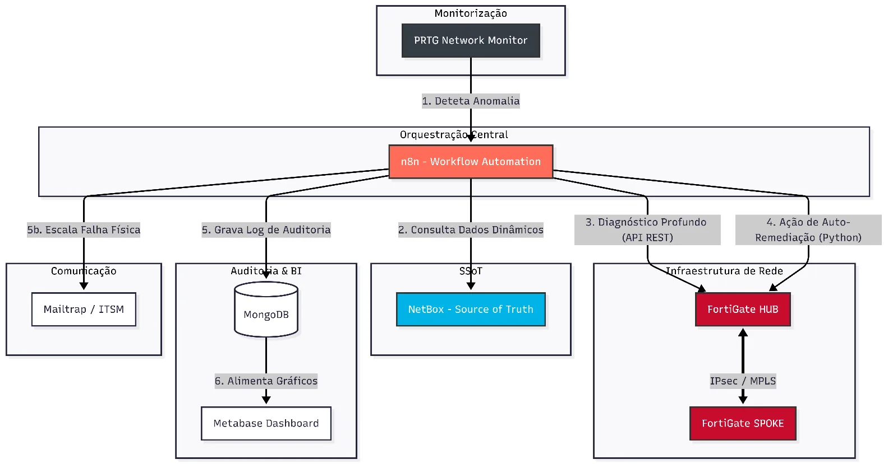

# Rafael Cruz — Portfolio

Network & Cloud Engineer (NetDevOps). Live site: **https://rafacr3z.github.io/portfolio/**



## What's here

- **Closed-loop simulator** in the hero: inject a fault (`rgwy_mismatch`, `phase2_mismatch`, `zero_traffic`, `policy_disabled`, `mpls_down`) and watch the PRTG → n8n → NetBox → FortiOS → MongoDB loop replay the capstone's chaos-engineering scenarios. Final durations match the lab measurements.
- **Case studies** structured as problem / my contribution / outcome, with measured results.
- **Writeups** as standalone, shareable pages in [`writeups/`](writeups/).
- **PT / EN** and **light / dark**, both remembered per visitor.

## Stack

Plain HTML, CSS and JavaScript, no build step and no framework.

```
index.html              main page (both languages inline, toggled via <html lang>)
writeups/*.html         technical articles
assets/css/main.css     design tokens, layout, light/dark themes
assets/js/main.js       theme, language, filters, lightbox, simulator
assets/img/             WebP images + Open Graph card
CV_*.pdf                downloadable CVs
```

Accessibility: semantic landmarks, keyboard-operable controls, native `<dialog>` lightbox, `prefers-reduced-motion` respected (the simulator renders instantly and nothing auto-moves).

## Run locally

```bash
python -m http.server 8000
# open http://localhost:8000
```

Deployed to GitHub Pages on every push to `main` (`.github/workflows/deploy.yml`).
